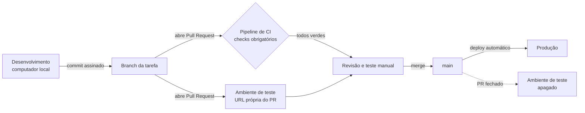

# Fluxo de trabalho

Como uma mudança sai do computador de quem desenvolve e chega a quem joga, e quais verificações ela atravessa no caminho.

Em uma frase: **nada chega à produção sem passar por testes automáticos, verificações de segurança e um ambiente de teste.**

## Visão geral



## Ambientes

| Ambiente | Onde roda | Para quê | Endereço |
|---|---|---|---|
| **Desenvolvimento** | Computador local | Escrever e testar enquanto desenvolve | `http://127.0.0.1:8080` |
| **Teste** | Railway, um por Pull Request | Testar a mudança online, inclusive no celular, antes de aprovar | `https://jogo-da-forca-web-jogo-da-forca-web-pr-<número>.up.railway.app` |
| **Produção** | Railway, branch `main` | O jogo que as pessoas usam | `https://jogo-da-forca-web-production.up.railway.app` |

**Como funciona o ambiente de teste**

- O Railway cria o ambiente sozinho quando um Pull Request é aberto e o apaga quando ele é mergeado ou fechado.
- **O ambiente de PR nasce com o deploy automático desligado.** Ao abrir o PR, o Railway publica o código daquele momento, mas os commits enviados depois só chegam ao ambiente se o deploy automático estiver ativo: no Railway, escolha o ambiente do PR, abra o serviço e vá em **Settings → Source → Enable** (ao lado de "Auto deploy is disabled").
- Alternativa: fechar e reabrir o PR recria o ambiente com o último commit, e a URL continua a mesma.
- Para confirmar qual versão está no ar, compare o conteúdo dos arquivos servidos com o build local: o status "Active" só diz que algum deploy está rodando, não qual.
- Cada ambiente tem as próprias partidas em memória: testar não afeta quem joga em produção.

**Decisões e por quê**

- *Um ambiente por PR, em vez de uma branch `staging` fixa.* Com uma pessoa no projeto, uma branch de staging exigiria dois PRs por mudança e aumentaria o risco de conflitos. Ambientes por PR só existem enquanto necessários, o que também reduz o custo.
- *PRs de bots (Dependabot) não ganham ambiente.* São atualizações de dependências já cobertas pelo CI; criar ambientes para elas só consumiria crédito.
- *"Focused PR Environments" desligado.* Com um único serviço no projeto, a opção não traz economia. Ela foi a primeira suspeita para os commits que não chegavam ao ambiente, mas a causa era o deploy automático desligado no ambiente de PR.
- *Variáveis copiadas da produção.* Os ambientes de teste herdam as variáveis de `production`. O risco é baixo porque o estado das partidas fica no servidor de cada ambiente: um cookie de teste levado à produção aponta para uma partida que não existe lá. Deve ser revisto se o projeto passar a guardar dados de usuários.

## Ciclo de uma mudança

1. **Branch.** Toda mudança nasce em uma branch própria a partir da `main` (ex.: `feat/ui-jogo`, `fix/chute-acento`).
2. **Commits.** Cada commit é uma mudança lógica, assinado com chave SSH (selo *Verified* no GitHub) e segue o padrão abaixo.
3. **Pull Request.** Descreve o que muda, por quê, os riscos e como validar.
4. **Verificação automática.** O CI roda os checks; o Railway publica o ambiente de teste.
5. **Teste manual.** A mudança é testada na URL do PR, no computador e no celular.
6. **Merge.** Com tudo verde, o PR entra na `main` por *merge commit*, preservando o histórico.
7. **Produção.** O Railway publica a `main` e confere o endpoint `/health`; se o deploy falhar, a versão anterior continua no ar.

## Padrão de commits

Segue [Conventional Commits](https://www.conventionalcommits.org/): tipo e escopo em inglês, descrição em português, no imperativo.

```
<tipo>(<escopo>): <o que a mudança faz>

<por que ela foi necessária, quando não for óbvio>
```

| Tipo | Quando usar | Exemplo |
|---|---|---|
| `feat` | Nova funcionalidade | `feat(ui): adiciona a tela de jogo neon em /beta` |
| `fix` | Correção de defeito | `fix(api): ignora acentos ao chutar a palavra` |
| `refactor` | Reorganização sem mudar comportamento | `refactor: separa o app.py em pacote` |
| `test` | Testes | `test(ui): cobre a partida de ponta a ponta` |
| `docs` | Documentação | `docs: descreve o fluxo de trabalho` |
| `build` | Ferramentas de build e dependências | `build(ui): configura Tailwind CSS 4` |
| `ci` | Pipeline de integração contínua | `ci: roda os testes de ponta a ponta` |
| `chore` | Manutenção geral | `chore(deploy): usa um único worker` |

## Pipeline de CI (DevSecOps)

A cada Pull Request e a cada mudança na `main`, o GitHub Actions executa as verificações abaixo. A segurança faz parte do ciclo inteiro, e não só do final.

| Check | O que verifica | Por que importa |
|---|---|---|
| **Lint (ruff)** | Padrão e erros comuns no Python | Código consistente e legível |
| **Testes (pytest)** | Regras do jogo e da API | Uma mudança não quebra o que já funcionava |
| **E2E (Playwright)** | Um navegador real joga partidas inteiras, em desktop e celular | Garante o fluxo como o usuário vê |
| **Interface (Tailwind)** | Compilação do CSS e do JavaScript | O mesmo build que o Railway roda |
| **SAST (bandit)** | Padrões inseguros no Python | Encontra falhas antes de chegarem à produção |
| **CodeQL** | Análise de segurança do Python e do JavaScript | Detecta vulnerabilidades mais sutis |
| **Dependências (pip-audit)** | Bibliotecas Python com falha conhecida (CVE) | Evita herdar vulnerabilidades de terceiros |
| **Dependências npm (audit)** | O mesmo para as bibliotecas JavaScript | Idem |
| **Segredos (gitleaks)** | Senhas ou chaves no histórico do git | Segredos só existem em variáveis de ambiente |

O workflow de segurança também roda toda segunda-feira, para pegar vulnerabilidades novas mesmo sem mudanças no código. O **Dependabot** abre PRs semanais para atualizar dependências Python, npm e as próprias Actions.

## Proteção da `main`

Um *ruleset* do GitHub garante que a `main` só muda do jeito certo, inclusive para quem administra o repositório:

- só por Pull Request;
- todos os checks obrigatórios precisam estar verdes;
- commits precisam ser assinados;
- a `main` não pode ser apagada nem ter o histórico reescrito.

**Check obrigatório × informativo.** Um check obrigatório bloqueia o merge se falhar. O deploy de teste do Railway aparece no PR como informativo: ele não roda nos PRs de bots, então torná-lo obrigatório bloquearia as atualizações do Dependabot, e o job *Interface (Tailwind)* já valida o mesmo build.

## Rodando localmente

Pré-requisitos: Python 3.12+ e Node 20+.

```bash
# dependências
python -m venv venv
source venv/bin/activate            # Windows (PowerShell): venv\Scripts\Activate.ps1
pip install -r requirements.txt -r requirements-dev.txt
npm install

# compilar a interface (CSS, JavaScript e fontes)
npm run build

# rodar
python app.py                       # http://127.0.0.1:8080
```

No PowerShell do Windows 5.1, `&&` não funciona: rode um comando por linha ou separe com `;`.

**Testes**

```bash
python -m pytest                    # testes de unidade e de API
playwright install chromium         # uma vez, para os testes de navegador
python -m pytest -m e2e             # testes de ponta a ponta (exigem npm run build)
```

Para os testes de navegador usarem o Edge já instalado no Windows: `E2E_CANAL=msedge`.

**Desenvolvendo a interface:** `npm run watch:css` e `npm run watch:js` recompilam a cada alteração.

## Glossário

- **Branch:** linha de trabalho paralela; permite mudar o código sem afetar a versão oficial.
- **Commit:** ponto salvo do código, com uma mensagem que descreve a mudança.
- **Pull Request (PR):** pedido para juntar uma branch à `main`, com descrição, revisão e verificações.
- **Merge:** a junção de uma branch à outra.
- **CI (Integração Contínua):** verificações automáticas a cada mudança.
- **Deploy:** publicar o código em um servidor.
- **Check:** uma verificação do CI; aparece verde (passou) ou vermelho (falhou) no PR.
- **Ruleset:** regras do GitHub que protegem uma branch.
- **E2E (ponta a ponta):** teste que usa o sistema como um usuário, do navegador ao servidor.
- **CVE:** identificador público de uma vulnerabilidade conhecida.
